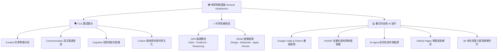

# 🌍 2026 臺北市立大學 地球環境暨生物資源學系
# 《地球物理通論》課程資源與全方位教學指引
## General Geophysics: Course Orientation, AI-assisted Inquiry, and Digital Workflow

[](https://github.com/)
[-green.svg)](https://github.com/)
[-red.svg)](https://www.utaipei.edu.tw/)
[](https://github.com/)
[](https://github.com/)
[](./2026_Utaipei_Geophysics-main/index.html)

> **課程核心理念 / Core Philosophy**  
> 「我們用**地球物理**來學習地球，用**英文**來接觸科學，用 **AI** 來協助探索，但最後用**自己的思考**來理解世界。」  
> *“We use geophysics to study the Earth, English to access science, AI to support exploration, and our own thinking to understand the world.”*

---

## 📌 目錄 (Table of Contents)

1. [課程基本資訊 (Course Overview)](#-課程基本資訊-course-overview)
2. [手繪手帳互動課程網頁亮點 (Interactive Web Experience)](#-手繪手帳互動課程網頁亮點-interactive-web-experience)
3. [核心教學架構與理念 (Core Frameworks)](#-核心教學架構與理念-core-frameworks)
   - [CLIL 雙語整合學習](#1-clil-雙語整合學習-content-and-language-integrated-learning)
   - [CER 與 DEAR 科學探究與建模](#2-科學探究與論證框架-cer--dear)
   - [AI 協作素養與互動日誌](#3-ai-協作與素養-ai-literacy--interaction-log)
4. [專案目錄架構與檔案清單 (Repository Structure)](#-專案目錄架構與檔案清單-repository-structure)
5. [18 週學習路線圖 (18-Week Roadmap)](#-18-週學習路線圖-18-week-roadmap)
6. [第一堂課 8 大通關任務 (Week 1 Onboarding Tasks)](#-第一堂課-8-大通關任務-week-1-onboarding-tasks)
7. [多元評量標準與成績計算 (Grading Policy)](#-多元評量標準與成績計算-grading-policy)
8. [CLIL 精選雙語科學思考句庫 (Essential CLIL Sentence Bank)](#-clil-精選雙語科學思考句庫-essential-clil-sentence-bank)
9. [教材使用與操作指南 (Getting Started & Usage)](#-教材使用與操作指南-getting-started--usage)
10. [授課師資與學術單位 (Instructor & Contact)](#-授課師資與學術單位-instructor--contact)

---

## 📌 課程基本資訊 (Course Overview)

- **課程名稱**：地球物理通論 (General Geophysics)
- **授課學期**：115 學年度第 1 學期（2026 秋季學期）
- **開課單位**：臺北市立大學 地球環境暨生物資源學系（UTaipei DEER，地生系二年級核心必修）
- **授課教師**：陳達毅 博士 / 助理教授 (Dr. Dayi Chen)
- **教學模式**：任務導向學習（Task-Based Learning）、雙語教學（CLIL / EMI）、AI 協作科學探究、雲端運算（Google Colab）與地球物理視覺化（PyGMT）、3D 地形/重力場建模與 3D 列印實作。

---

## 🎨 手繪手帳互動課程網頁亮點 (Interactive Web Experience)

本專案附帶完整獨立打造的課程互動網頁 [`2026_Utaipei_Geophysics-main/index.html`](./2026_Utaipei_Geophysics-main/index.html)，採用極具創意的**手繪塗鴉手帳風格（Doodle Notebook Design System）**，包含以下豐富互動機能：

- 📔 **手繪紙本與教室黑板雙主題切換**：內建經典牛皮手帳紙材質與夜間粉筆黑板模式（Chalkboard Mode）。
- 🔊 **Web Audio 原生手繪音效系統**：翻頁、按鈕點擊與通關打勾皆有逼真粉筆與紙張音效（支援隨時靜音）。
- 🚀 **第 1 週 8 大通關任務互動勾選清單**：即時掌握學習進度，完成全部 8 項任務時觸發全螢幕彩花慶祝動畫（Confetti Canvas）。
- 🧮 **互動成績試算器（Grading Calculator）**：滑動期中考、專題實作與平時表現滑桿，即時動態計算學期總成績並給予學習反饋。
- 🤖 **AI 提問好壞對照實驗室與 AI Log 產生器**：提供「不良提問」與「黃金提問」對照範例，並有一鍵複製標準 AI Interaction Log 模板。
- 🗣️ **CLIL 科學論述六句組互動複製**：點擊即可複製標準中英雙語科學論述句型。
- 🎨 **手繪塗鴉互動彩蛋畫布（Doodle Sketchpad）**：支援多色選擇、手繪筆跡儲存與清除。
- ❓ **便籤問答牆（FAQ Accordion）**：收錄常見英文聽不懂、沒寫過程式、AI 使用界線等新生的疑惑解方。

> 💡 **瀏覽方式**：直接雙擊打開 [`2026_Utaipei_Geophysics-main/index.html`](./2026_Utaipei_Geophysics-main/index.html) 或使用 VS Code 的 Live Server 即可體驗。

---

## 💡 核心教學架構與理念 (Core Frameworks)

本課程顛覆傳統單向講述模式，整合「地球物理科學專業」、「雙語溝通（CLIL）」與「AI 數位工具鏈」，強調「像科學家一樣思考與研究」：



### 1. CLIL 雙語整合學習 (Content and Language Integrated Learning)
- **核心定位**：非為了學文法而學英文，而是學會使用英文作為**獲取前沿新知、精確描述自然現象、呈現證據與進行國際學術溝通**的實用工具。
- **4C 整合架構**：
  - **Content (內容)**：折射震測、重力異常、地磁條帶、地電阻抗、地熱流與全球板塊構造動力學。
  - **Communication (溝通)**：專業名詞掌握、科學論述句型庫、中英雙語報告發表。
  - **Cognition (認知)**：現象觀察、假說擬定、數據驗證、批判性思維與模型反覆修訂。
  - **Culture (文化)**：推廣開放地球科學資料（Open Data）、科學研究透明度與成果可重現性（Reproducibility）。

### 2. 科學探究與論證框架 (CER & DEAR)
- **CER 論證三要素**：
  - **Claim (主張)**：根據觀測，你提出什麼明確假說或推論？
  - **Evidence (證據)**：有什麼儀器量測數據、走時曲線、重力異常分佈圖支撐你的主張？
  - **Reasoning (推理)**：如何運用物理原理（如司乃耳定律、牛頓萬有引力、熱傳導方程式）串接證據與主張？
- **DEAR 建模反覆循環**：
  - **D (Design)**：設計初始簡化模型（例如：均質平坦雙層地層）。
  - **E (Elaborate)**：加入更多野外觀測數據與約束條件，精緻化地層模型。
  - **A (Apply)**：運用模型進行推論與預測其他未測區域的地質構造。
  - **R (Revise)**：發現反常或不吻合的資料時，勇敢反思並重構地質模型。

### 3. AI 協作與素養 (AI Literacy & Interaction Log)
- **協作者精神**：將 Gemini、Codex、Antigravity、OpenCode 視為 24 小時研究助手與除錯夥伴，而非偷懶代寫代抄工具。
- **核心鐵律**：`「AI 可以產生答案，但理解、驗證與判斷答案永遠是你的責任。」`
- **AI Interaction Log 規範**：每次作業與專題均須繳交 AI 互動日誌，嚴格記錄：
  1. 初始提問 Prompt 與上下文情境。
  2. AI 產生的原始回覆。
  3. 自主查證過程（官方文獻、教科書公式、真實地震資料）。
  4. 發現的謬誤或模型修正歷程與反思。

---

## 📂 專案目錄架構與檔案清單 (Repository Structure)

專案結構清晰，將互動網頁、雙語講稿、教學投影片與句型庫系統化整理：

```text
2026_Utaipei_Geophysics-main/
│
├── 📖 README.md                                          # 專案總導覽與教學資源指南 (本檔案)
│
└── 📁 2026_Utaipei_Geophysics-main/                      # 課程核心專案目錄
    ├── 🌐 index.html                                    # 手繪塗鴉手帳風格全互動課程指南主頁
    ├── 📖 README.md                                      # 課程詳細指引與學習手冊
    │
    └── 📁 2026_Utaipei_Geophysics_0909/                  # 核心教材、講稿與投影片庫
        ├── 🌐 index.html                                # 課程指南互動網頁備份鏡像
        ├── 📖 README.md                                  # 第一週課程詳細指引與學習手冊
        ├── 📑 地球物理通論_第一堂課_PPT詳細版.md           # Marp 格式雙語教學投影片（16:9，1450+ 行）
        ├── 🎙️ 地球物理通論第一堂課｜3小時中英文對照完整講稿.md# 第一堂課 09:00-12:00 全時段雙語逐字授課講稿
        ├── 💡 地球物理第一次上課_中英對照講稿.md             # 雙語開場理念與 CER 思考講稿精簡版
        └── 🗣️ 地球物理通論第一堂課｜CLIL句型與三例擴充附錄.md # CLIL Level 1~8 雙語科學論述句型庫與三例擴充
```

### 專案重要檔案對照表

| 檔案名稱 | 核心內容與格式 | 適用情境與主要用途 |
|---|---|---|
| [`index.html`](./2026_Utaipei_Geophysics-main/index.html) | **手繪手帳互動課程網頁**（純 HTML/CSS/JS，無外部龐大相依） | 學生課堂導航、互動成績試算、通關任務勾選、Prompt 實驗 |
| [`地球物理通論_第一堂課_PPT詳細版.md`](./2026_Utaipei_Geophysics-main/2026_Utaipei_Geophysics_0909/地球物理通論_第一堂課_PPT詳細版.md) | **Marp 雙語教學投影片**（16:9 比例，包含 18 週地圖與評量標準） | 教師上課簡報、學生課後複習、導出 PDF/HTML 投影片 |
| [`地球物理通論第一堂課｜3小時中英文對照完整講稿.md`](./2026_Utaipei_Geophysics-main/2026_Utaipei_Geophysics_0909/地球物理通論第一堂課｜3小時中英文對照完整講稿.md) | **3 小時全時段雙語逐字講稿**（依時間軸細分 8 大任務與黑板板書） | 授課口播指導、EMI 雙語課堂即時對照、教學觀摩 |
| [`地球物理第一次上課_中英對照講稿.md`](./2026_Utaipei_Geophysics-main/2026_Utaipei_Geophysics_0909/地球物理第一次上課_中英對照講稿.md) | **開場理念與 CER 思考講稿精簡版**（深入淺出闡述為何用英文學科學） | 學生課前導讀、精簡版開學第一課觀念引導 |
| [`地球物理通論第一堂課｜CLIL句型與三例擴充附錄.md`](./2026_Utaipei_Geophysics-main/2026_Utaipei_Geophysics_0909/地球物理通論第一堂課｜CLIL句型與三例擴充附錄.md) | **CLIL 雙語句庫手冊**（Level 1~8 階梯句型、每句附 3 個地球物理例句） | 學生撰寫全英/雙語報告、小組討論發言、期末專題發表句型庫 |

---

## 🗺️ 18 週學習路線圖 (18-Week Roadmap)

```text
Week 01 ─── 🧭 課程導航、任務模式、數位工具鏈建置 (GitHub / Colab / AI Agent)
Week 02 ─── 🗺️ 地球物理視覺化：PyGMT 繪製全球地形與板塊邊界圖
Week 03-04 ─ 🧱 板塊構造與板塊邊界 3D 數位建模與實體 3D 列印
Week 05 ─── 🔨 校園野外探勘實作：折射震測探勘實地量測與檢波器佈線
Week 06-07 ─ 📈 折射震測原理、初達波走時曲線分析與地下雙層模型建構
Week 08 ─── 📝 期中檢核與理論測驗 (40%)
Week 09-10 ─ ⚖️ 重力探勘實務：地下密度異常分析與大地水準面 (Geoid) 建模
Week 11 ─── 🎤 專家專題講座：地球物理於防災減災與產官學界前沿應用
Week 12 ─── ♨️ 地熱流分析：地溫梯度量測、熱傳導計算與地熱能源探勘
Week 13-14 ─ ⚡ 地電與地磁方法：視電阻率測深、地磁倒轉與海底擴張條帶
Week 15-16 ─ 🚀 期末專題雙語成果公開發表 (GitHub Pages 互動網站成果展示)
Week 17-18 ─ 🚌 校外實習考察：國家地震工程研究中心 (NCREE) / 中央氣象署 (CWA) 參訪
```

---

## 🚀 第一堂課 8 大通關任務 (Week 1 Onboarding Tasks)

每位同學與小組需在第一週課堂結束前完成以下 8 項具體通關任務：

- [ ] **任務 1：自主分組完成**（2–3 人一組，推選組長，分配初期工作角色：`Data/Code`、`Explanation/CLIL`、`Design/Web/3D`）。
- [ ] **任務 2：GitHub 學習儲存庫設定**（建立個人或團隊專屬儲存庫 `geophysics-learning-2026` 並啟用 GitHub Pages）。
- [ ] **任務 3：Google Colab 雲端環境啟動**（建立第一個筆記本 `Week01_Geophysics_First_Inquiry.ipynb`，成功執行 Python 測試程式碼）。
- [ ] **任務 4：AI 批判引導式探究**（於 Gemini / Codex 輸入階梯式 Prompt，探討「全球地震與海溝分佈規律」，嚴禁索取現成答案）。
- [ ] **任務 5：CER 論證結構萃取**（將課堂探究整理為明確的 **Claim**、**Evidence** 與 **Reasoning** 結構）。
- [ ] **任務 6：DEAR 初步模型建立**（完成 **Design** 初模、**Elaborate** 精緻化、**Apply** 應用與 **Revise** 修正記錄）。
- [ ] **任務 7：AI Interaction Log 規範存檔**（儲存 Prompt、AI 回覆、查證資料出處與批判反思，格式化為 Markdown 檔案）。
- [ ] **任務 8：Exit Ticket 課堂反思回饋**（填寫 3 句今日學習收穫、困難點與下週期待）。

---

## 📊 多元評量標準與成績計算 (Grading Policy)

| 評量項目 | 比例 | 評定標準與考核重點 |
|---|:---:|---|
| **期中檢核考** | **40%** | 地球物理四大領域（震測、重力、地磁、熱流與板塊構造）之基本物理原理、公式推導與實務觀念分析。 |
| **實作與專題作業** | **50%** | Google Colab 程式碼品質、PyGMT 視覺化地圖、3D 地形列印成果、AI Interaction Log 嚴謹度、CER/DEAR 探究歷程紀錄、GitHub Pages 期末專題網站公開成果。 |
| **平時課堂表現** | **10%** | 課堂出席與專注度、分組合作與同儕互評、CLIL 雙語課堂提問交流、每週 Exit Ticket 繳交狀況。 |

> ⚠️ **核心評分準則**：本課程**不以單純產出結果論成敗**，特別重視**思考探究歷程的嚴謹性、對 AI 產出的獨立懷疑態度，以及模型迭代修正的邏輯**。

---

## 🗣️ CLIL 精選雙語科學思考句庫 (Essential CLIL Sentence Bank)

教材 [`2026_Utaipei_Geophysics_0909/地球物理通論第一堂課｜CLIL句型與三例擴充附錄.md`](./2026_Utaipei_Geophysics-main/2026_Utaipei_Geophysics_0909/地球物理通論第一堂課｜CLIL句型與三例擴充附錄.md) 收錄了由淺入深 8 個等級的科學句型，以下為撰寫作業與口頭報告必備之核心句式：

### 🎯 科學論述六句組 (Six-Sentence Scientific Argument)
1. **Observation (觀察)**：`We observe that [phenomenon].`（我們觀察到……）
2. **Question (提問)**：`We want to know why [phenomenon occurs].`（我們想探究為什麼……）
3. **Hypothesis (假說)**：`We hypothesize that [explanation].`（我們假設……）
4. **Prediction (預測)**：`If our hypothesis is correct, we expect [prediction].`（若假說正確，我們預期……）
5. **Evidence (證據)**：`The evidence shows that [data pattern].`（觀測數據與證據顯示……）
6. **Conclusion/Revision (結論或修正)**：`Therefore, we support / revise our model.`（因此我們支持／修正我們的模型。）

### 🤖 AI 批判協作引導句型 (AI Critical Prompting)
- `Do not give me the final answer directly. Guide me step by step.`（請不要直接給我最終答案，請一步步引導我思考。）
- `What geophysical evidence can support or challenge this claim?`（有什麼地球物理證據可以支持或質疑這個主張？）
- `What are the underlying physical assumptions of this model?`（這個模型背後的物理假設是什麼？）

---

## 🛠️ 教材使用與操作指南 (Getting Started & Usage)

### 1. 預覽與互動學習網頁
- 專案首頁 [`2026_Utaipei_Geophysics-main/index.html`](./2026_Utaipei_Geophysics-main/index.html) 為純前端網頁，支援各主流現代瀏覽器（Chrome, Edge, Firefox, Safari）。
- 無須設定後端伺服器，直接按右鍵「以瀏覽器開啟」即可享受完整互動體驗。

### 2. 使用 Marp 編輯與播放簡報
- 教學投影片 [`地球物理通論_第一堂課_PPT詳細版.md`](./2026_Utaipei_Geophysics-main/2026_Utaipei_Geophysics_0909/地球物理通論_第一堂課_PPT詳細版.md) 採用 [Marp Markdown](https://marp.app/) 標準撰寫。
- 在 VS Code 中安裝擴充功能 **Marp for VS Code** (`marp-team.marp-vscode`)。
- 開啟檔案後點擊右上角 Marp 圖示，可即時全螢幕預覽簡報，或輸出為 **PDF**、**HTML 簡報** 或 **PPTX**。

### 3. Google Colab 雲端筆記本使用建議
- 所有程式實作建議於 Google Colab 執行，免除本地安裝 Python 與 GMT 地球物理套件的複雜環境依賴。
- 程式筆記本請定期 Commit 同步回各組的 GitHub 儲存庫 `geophysics-learning-2026`。

---

## 👨‍🏫 授課師資與學術單位 (Instructor & Contact)

- **授課教師**：陳達毅 博士 / 助理教授 (Dr. Dayi Chen)
- **任職單位**：臺北市立大學 地球環境暨生物資源學系 (Department of Earth and Life Science, University of Taipei)
- **專業研究領域**：
  - 震測學與地震學 (Seismology & Seismic Exploration)
  - 地震預警系統研發與地震測報 (Earthquake Early Warning Systems)
  - 地球物理資料反演與分析 (Geophysical Data Inversion & Analysis)
  - 數位科學教育與生成式 AI 輔助探究 (AI-assisted Science Education)
- **校園位置**：100025 臺北市中正區愛國西路 1 號
- **學系網站**：[臺北市立大學 地生系官方網站](https://deer.utaipei.edu.tw/)

---

<div align="center">
  <p><sub>臺北市立大學 地球環境暨生物資源學系 ‧ 115 學年度第 1 學期《地球物理通論》課程教學團隊製作</sub></p>
  <p><sub>All Materials licensed for educational use at UTaipei. Powered by Modern Geophysics & AI Inquiries.</sub></p>
</div>
